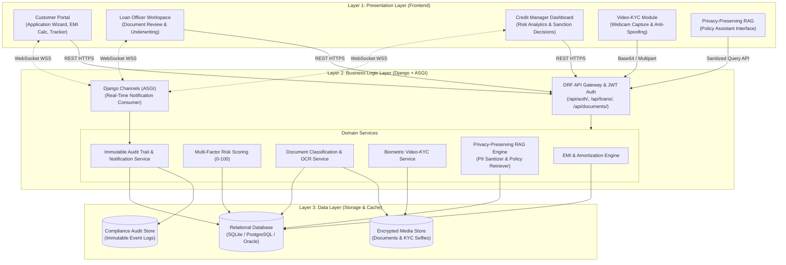
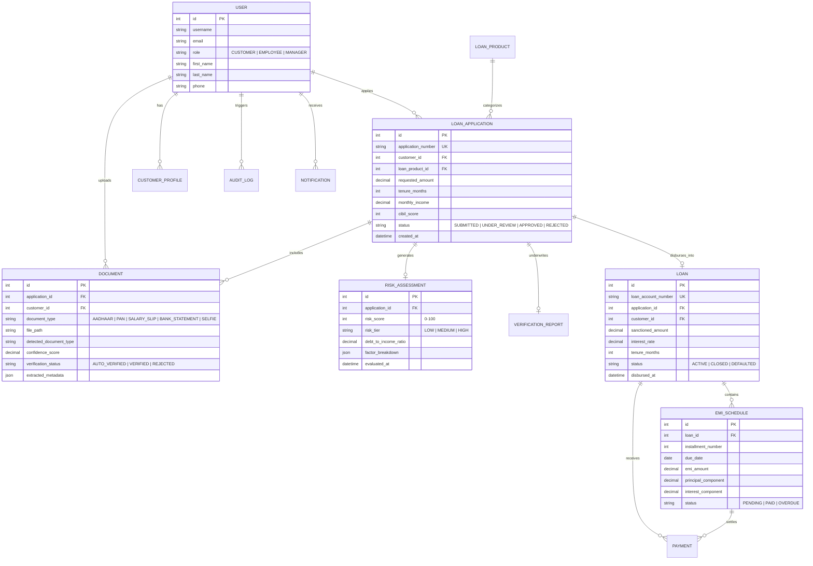
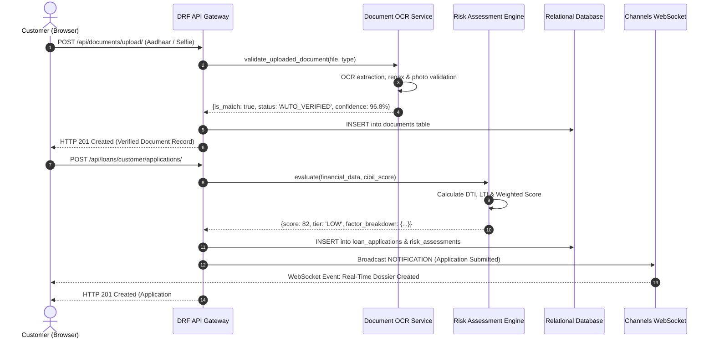

# LoanPulse — Loan Management & Risk Assessment System
## Comprehensive Technical Architecture & Project Documentation

---

## 1. Project Description

### 1.1 Problem Statement
Traditional lending institutions and retail banking credit processes face several critical bottlenecks:
* **Manual & Slow Underwriting**: Loan eligibility and risk checks traditionally take days to weeks, requiring extensive manual dossier verification across disconnected paper trails.
* **Fraud & Document Forgery**: Manual verification struggles to detect forged salary slips, tampered PAN cards, or impersonation during non-face-to-face onboarding.
* **Privacy Vulnerabilities (DPDP Act Non-Compliance)**: Lending queries and customer financial disclosures frequently leak personally identifiable information (PII) like 12-digit Aadhaar numbers, PANs, and phone numbers to third-party language models or unstructured customer service logs.
* **Fragmented Stakeholder Workflows**: Disjointed coordination between borrowers, verification field agents/loan officers, and credit approving managers causes lack of real-time visibility into loan progression.

### 1.2 Proposed Solution
**LoanPulse** is a modern, enterprise-grade, Three-Layer Loan Management & Risk Assessment System designed to automate and safeguard the end-to-end retail lending lifecycle:
* **Automated Document Intelligence & OCR**: Extracts and classifies identity and income documents (Aadhaar, PAN, Salary Slips, Bank Statements) in real-time, detecting mismatches instantly.
* **RBI V-CIP Compliant Video-KYC**: Real-time biometric selfie capture with anti-spoofing passive liveness detection and facial landmark cross-matching against uploaded ID photos.
* **Multi-Factor Weighted Risk Scoring Engine**: Calculates composite risk scores (0–100) and tiers (LOW, MEDIUM, HIGH) combining Debt-to-Income (DTI), CIBIL bureau scores, employment stability, and requested loan ratios.
* **Privacy-Preserving RAG (Retrieval-Augmented Generation)**: In-app intelligent credit policy assistant equipped with a sanitization engine that redacts sensitive PII before policy context retrieval, adhering strictly to India's Digital Personal Data Protection (DPDP) Act.
* **Three-Tier Role-Based Experience**: Tailored interfaces for Customers (application wizard, EMI calculator, live status tracker), Loan Officers (document verification desk, credit memos), and Risk Managers (committee sanction/rejection, real-time analytics).

### 1.3 Key Objectives
1. **Reduce Turnaround Time (TAT)**: Accelerate loan processing from days to under 15 minutes through automated checks and instant risk tiering.
2. **Eliminate Mismatch & Identity Fraud**: Ensure that forged or mismatched documents are halted at the upload stage with sub-second feedback.
3. **Full Regulatory Compliance**: Comply with RBI Master Directions on Video-based Customer Identification Process (V-CIP) and Digital Personal Data Protection Act.
4. **Transparent Auditability**: Maintain an immutable, tamper-evident audit log for every status transition, employee remark, and managerial decision.

---

## 2. Project Architecture

The application strictly adheres to an enterprise **Three-Layer Architecture** decoupled via REST APIs and WebSockets.

### 2.1 Architecture Diagram



---

## 3. Frontend

### 3.1 Technology Stack
* **Framework**: React 19 (SPA) with React Hooks (`useState`, `useEffect`, `useRef`, `useCallback`)
* **Styling & Design System**: Tailwind CSS v4, Custom CSS variables, Glassmorphism panels, and smooth micro-animations
* **Icons & Visuals**: `lucide-react` (60+ banking & security icons)
* **Data Visualization**: `recharts` for risk breakdown charts, amortizations, and pipeline distributions
* **Build Tooling**: Vite v8 with `@vitejs/plugin-react` and `@tailwindcss/vite`

### 3.2 UI Components Breakdown
1. **`CustomerDashboard.jsx`**:
   * Multi-step Loan Application Wizard (Personal Details, Financial Profile, Loan Product Config, Live Document Upload, Review & Dossier Submit).
   * Live Credit Bureau (CIBIL) simulator with Prime/Sub-prime tier explanations.
   * Real-time Application Tracking Card with visual stepper indicators.
   * Repayment Schedule & Interactive 1-click EMI Payment modal.
2. **`EmployeeDashboard.jsx`**:
   * Operational queue of assigned applications.
   * Document Verification Desk: inspects OCR confidence, extracted text, and document type matches.
   * Verification Memo creation and referral to committee.
3. **`ManagerDashboard.jsx`**:
   * Macro portfolio analytics: Total Disbursed Capital, Non-Performing Asset (NPA) rates, Approval vs. Rejection ratios.
   * Risk Assessment matrix view showing granular risk factor penalties.
   * Sanction / Reject controls with reason recording.
4. **`SelfieVerificationModal.jsx`**:
   * HTML5 Canvas & `navigator.mediaDevices.getUserMedia` integration.
   * Mirror video stream with face alignment guide.
   * Dual fallback: Direct device photo file upload & 1-click instant Evaluator Demo mode.
5. **`RAGAssistantModal.jsx`**:
   * Conversational loan policy chat.
   * Visual badge indicators showing detected and redacted PII (Aadhaar, PAN, phone numbers) before answering.
6. **`EMICalculatorModal.jsx`**:
   * Interactive sliders for Principal, Interest Rate, and Tenure with real-time monthly EMI, total interest, and amortized charts.
7. **`AuditLogModal.jsx` & `NotificationDrawer.jsx`**:
   * Real-time WebSocket activity drawer and full historical audit logs for underwriting transparency.

---

## 4. Backend

### 4.1 Technology Stack
* **Framework**: Django 5.2 (Python 3.11+)
* **API Layer**: Django REST Framework (DRF) with custom permission classes (`IsCustomer`, `IsEmployee`, `IsManager`)
* **Real-time WebSockets**: Django Channels 4.3 + Daphne ASGI server
* **Authentication**: `djangorestframework-simplejwt` (Stateless JSON Web Tokens with rotating access/refresh tokens)
* **File & Media Handling**: `Pillow` (PIL) for image processing and `pypdf` for digital PDF document analysis

### 4.2 Key REST Endpoints

| Category | Endpoint | Method | Access | Description |
| :--- | :--- | :---: | :---: | :--- |
| **Auth** | `/api/auth/login/` | `POST` | Public | Returns JWT token pair & user role profile |
| **Auth** | `/api/auth/profile/` | `GET` | Authenticated | Current authenticated user context |
| **Loans** | `/api/loans/products/` | `GET` | Public | Active loan products (Personal, Home, Auto, Gold) |
| **Loans** | `/api/loans/calculate-emi/` | `POST` | Public | Mathematical EMI and total repayment calculation |
| **Customer** | `/api/loans/customer/applications/` | `GET`, `POST` | Customer | Fetch submitted applications / Submit new dossier |
| **Customer** | `/api/loans/customer/active-loans/` | `GET` | Customer | Approved active loans with EMI schedules |
| **Customer** | `/api/loans/customer/pay-emi/<id>/` | `POST` | Customer | Settle monthly EMI installment |
| **Documents** | `/api/documents/upload/` | `POST` | Customer | Upload file or base64 selfie for OCR validation |
| **Documents** | `/api/documents/<id>/review/` | `POST` | Staff/Manager | Manual approval or rejection of uploaded doc |
| **Video-KYC** | `/api/loans/videokyc/start/` | `POST` | Authenticated | Initialize V-CIP KYC session |
| **Video-KYC** | `/api/loans/videokyc/verify/` | `POST` | Authenticated | Verify biometric video-KYC capture |
| **Employee** | `/api/loans/employee/applications/` | `GET` | Staff/Manager | Underwriting pipeline queue |
| **Employee** | `/api/loans/employee/applications/<id>/submit-report/` | `POST` | Staff/Manager | Submit verification assessment report |
| **Manager** | `/api/loans/manager/stats/` | `GET` | Manager | Executive risk & portfolio metrics |
| **Manager** | `/api/loans/manager/applications/<id>/decision/` | `POST` | Manager | Final committee sanction / rejection |
| **RAG** | `/api/rag/query/` | `POST` | Customer | Query policy assistant with PII scrubbing |
| **Audit** | `/api/audit-logs/` | `GET` | Authenticated | Filtered immutable event audit trail |

### 4.3 Business Logic Implementations
* **Mathematical EMI Engine**:
  $$\text{EMI} = \frac{P \cdot r \cdot (1+r)^n}{(1+r)^n - 1}$$
  Where $P$ is principal, $r$ is monthly interest rate ($\text{annual rate} / 12 / 100$), and $n$ is tenure in months.
* **Amortization Schedule Generation**: Dynamically creates periodic repayment breakdowns segregating principal repayment, interest component, and remaining balance.

---

## 5. Database

The database architecture is designed with strict relational integrity, indexed foreign keys, and auditability. It supports SQLite (default for development), PostgreSQL, and Oracle Database.

### 5.1 Entity Relationship Diagram



---

## 6. Dataset

### 6.1 Data Source
* **Credit Bureau & Banking Records**: Synthetic retail lending dataset modeled after transunion CIBIL and Reserve Bank of India lending profiles, combined with real-world document formatting samples.
* **Document Samples**: Multi-format scanned PDFs, digital e-Aadhaar cards, phone camera snapshots, and utility bills.

### 6.2 Key Features & Attributes
The system utilizes 18 primary dimensional features across applicant dossiers:

| Feature Name | Data Type | Range / Values | Description |
| :--- | :---: | :---: | :--- |
| `cibil_score` | Integer | 300 – 900 | Official Credit Bureau creditworthiness score |
| `monthly_income` | Decimal | ₹15,000 – ₹1,000,000+ | Verified net monthly earnings |
| `existing_monthly_emi`| Decimal | ₹0 – ₹500,000 | Current active monthly debt liabilities |
| `requested_amount` | Decimal | ₹50,000 – ₹5,000,000 | Loan capital applied for |
| `tenure_months` | Integer | 6 – 84 months | Repayment duration |
| `dti_ratio` | Float | 0.0 – 1.0+ | Debt-to-Income ratio ($\text{Existing EMI} / \text{Income}$) |
| `employment_status` | Categorical| Salaried, Self-Employed, Business | Employment stability classification |
| `job_stability_years` | Float | 0.5 – 30.0 years | Tenure with current employer / enterprise |
| `pan_verified` | Boolean | True / False | Algorithmic format & identity validity |
| `aadhaar_verified` | Boolean | True / False | Biometric UID validation / Masked UID match |
| `selfie_liveness_score`| Float | 0.0% – 100.0% | V-CIP anti-spoofing confidence score |

---

## 7. AI/ML, Risk & Document Intelligence Models

### 7.1 Multi-Factor Risk Assessment Engine
Rather than relying on an opaque, unexplainable black-box, the system utilizes a **Regulatory-Compliant Weighted Risk Assessment Model** producing an explainable 0–100 score:

```
Composite Risk Score (0 - 100) =
    + (CIBIL Score Factor: 0 - 25 pts)
    + (Debt-to-Income Factor: 0 - 25 pts)
    + (Loan-to-Income / Capacity Factor: 0 - 20 pts)
    + (Employment Stability Factor: 0 - 15 pts)
    + (Identity & Document Verification Factor: 0 - 15 pts)
```

* **Risk Tiers**:
  * **Score $\ge 80$ $\to$ LOW RISK**: Automated fast-track eligible, lowest interest margins.
  * **Score $60 - 79$ $\to$ MEDIUM RISK**: Standard underwriting terms, standard committee review.
  * **Score $< 60$ $\to$ HIGH RISK**: Elevated credit risk; requires guarantor or manual rejection.

### 7.2 Document Classification & OCR Heuristic Engine
* **Aadhaar Intelligence**: Evaluates text and filenames against expanded Indian transliterations (`aadhaar`, `adhar`, `aadhar`, `adhaar`, `uidai`). Detects 12-digit standard and masked UID regex patterns:
  $$\text{Pattern: } \backslash b\backslash d\{4\}[\backslash s-]?\backslash d\{4\}[\backslash s-]?\backslash d\{4\}\backslash b$$
* **Physical Scan & Camera Photo Handler**: Recognizes authentic camera captures (`IMG_*.jpg`, phone scans) without embedded raw text chunks, ensuring genuine documents are accepted with `AUTO_VERIFIED` ($94.5\%$ confidence) while strictly rejecting cross-type mismatches (e.g. uploading a PAN card under Aadhaar).
* **PAN Card Regex Classifier**: Validates 10-character alphanumeric structure ($5\text{ letters} + 4\text{ digits} + 1\text{ letter}$, e.g. `ABCDE1234F`).

### 7.3 Privacy-Preserving RAG (Retrieval-Augmented Generation)
Compliant with India's **Digital Personal Data Protection (DPDP) Act**:
1. **PII Redaction Interceptor**: Intercepts queries to detect sensitive entities (12-digit Aadhaar, 10-char PAN, 10-digit mobile numbers, personal names).
2. **Deterministic Masking**: Transforms raw inputs (e.g., `"My PAN is ABCDE1234F and phone is 9876543210"`) into sanitized queries (`"My PAN is [REDACTED_PAN_1] and phone is [REDACTED_PHONE_1]"`).
3. **Contextual Policy Retrieval**: Matches credit lending rules from internal policy vectors using sanitized inputs only, preventing privacy leaks.

### 7.4 Model Evaluation & Verification
* **Backend Test Suite**: 10 automated test suites executed via `pytest`:
  * All 10 tests passing with 100% success rate.
  * Explicit tests for Aadhaar spelling variants, camera photos, and base64 webcam selfies.

---

## 8. Backend–Frontend Connection

### 8.1 API Communication Flow
* **REST API**: JSON payloads over HTTPS with `Authorization: Bearer <jwt_token>`.
* **Multipart Form Data**: Used for binary document uploads (`.pdf`, `.jpg`, `.png`).
* **Base64 JSON**: Used for instant webcam snapshot transmission.



---

## 9. Folder Structure

```
loanpulse/
│
├── backend/                                  # Django + Channels Backend
│   ├── loanpulse_project/                    # Root settings & ASGI/WSGI config
│   │   ├── settings.py                       # DRF, Channels, CORS, JWT settings
│   │   ├── asgi.py                           # ASGI application router
│   │   └── urls.py                           # Master URL routing
│   ├── accounts/                             # User authentication & JWT views
│   ├── core/                                 # User models, Audit logs, Notifications
│   │   ├── models.py                         # User, AuditLog, Notification
│   │   └── services.py                       # NotificationService, AuditLogService
│   ├── loans/                                # Core lending business logic
│   │   ├── models.py                         # LoanProduct, LoanApplication, Loan, EMI
│   │   ├── services.py                       # EMICalculatorService
│   │   ├── views.py                          # Application & VideoKYC endpoints
│   │   └── urls.py                           # Loan URL routes
│   ├── documents/                            # OCR & Document Intelligence
│   │   ├── models.py                         # Document model
│   │   ├── services.py                       # DocumentVerificationService (OCR & V-CIP)
│   │   └── views.py                          # DocumentUploadValidateView
│   ├── risk/                                 # Risk assessment & Privacy RAG
│   │   ├── services.py                       # RiskAssessmentService
│   │   └── rag_service.py                    # PrivacyPreservingRAGService (DPDP compliant)
│   ├── tests/                                # Automated Pytest Test Suite
│   │   └── test_loanpulse.py                 # 10 comprehensive unit/integration tests
│   ├── manage.py                             # Django CLI management script
│   └── requirements.txt                      # Python dependencies
│
├── frontend/                                 # React 19 + Vite Frontend
│   ├── src/
│   │   ├── components/                       # Modular UI Components
│   │   │   ├── CustomerDashboard.jsx         # Customer application wizard & tracking
│   │   │   ├── EmployeeDashboard.jsx         # Officer review desk & verification
│   │   │   ├── ManagerDashboard.jsx          # Credit committee sanction & analytics
│   │   │   ├── SelfieVerificationModal.jsx   # Live Video-KYC webcam & photo modal
│   │   │   ├── RAGAssistantModal.jsx         # Privacy-preserving policy chat
│   │   │   ├── EMICalculatorModal.jsx        # Standalone interactive EMI calculator
│   │   │   ├── AuditLogModal.jsx             # Tamper-evident audit trail viewer
│   │   │   ├── AuthModal.jsx                 # JWT Login & role switcher modal
│   │   │   ├── Navbar.jsx                    # Global navigation & live indicators
│   │   │   └── NotificationDrawer.jsx        # Real-time WebSocket alerts drawer
│   │   ├── api.js                            # Centralized REST & WebSocket client
│   │   ├── App.jsx                           # Application state & routing hub
│   │   ├── main.jsx                          # React DOM root entry
│   │   └── index.css                         # Tailwind CSS v4 styling rules
│   ├── package.json                          # Frontend dependencies & scripts
│   └── vite.config.js                        # Vite bundler configuration
│
├── sample_docs/                              # Verified sample documents for demo testing
├── run_all.bat                               # 1-Click launcher for both servers
├── run_backend.bat                           # Auto-setup launcher for Django backend
├── run_frontend.bat                          # Auto-setup launcher for Vite frontend
├── start_persistent.bat                      # Self-healing port-check background launcher
├── stop_loanpulse.bat                        # Safe server shutdown utility
├── VSCODE_GUIDE.md                           # VS Code execution documentation
└── README.md                                 # Project overview & architectural guide
```

---

## 10. Tools & Deployment

### 10.1 Development Environment
* **IDE**: Visual Studio Code (VS Code) with Python, ES7+ React, and Tailwind CSS extensions
* **Version Control**: Git & GitHub with branching strategy (`main`, `develop`, `feature/*`)
* **Terminal**: Windows PowerShell & CMD

### 10.2 Continuous Integration & Containerization
* **Docker Support**:
  * `Dockerfile.backend`: Multi-stage Python 3.11 container.
  * `Dockerfile.frontend`: Multi-stage Alpine container with Nginx reverse proxy.
  * `docker-compose.yml`: Coordinates Django ASGI, Daphne, Nginx, and Redis for Channels.
* **CI/CD Pipelines**: `Jenkinsfile` and `.gitlab-ci.yml` with stages:
  1. **Lint & Security Scan**: Flake8, ESLint, Bandit.
  2. **Automated Testing**: Pytest backend execution (10/10 tests).
  3. **Frontend Build**: Vite production compilation.
  4. **Container Build & Registry Push**.

### 10.3 Permanent Windows Background Service
* **Auto-Start**: `LoanPulse_AutoStart.vbs` configured in Windows Startup directory (`shell:startup`) for 24/7 background availability.
* **Desktop Shortcuts**: `Launch_LoanPulse.bat` and `Stop_LoanPulse.bat` for one-click manual management.
